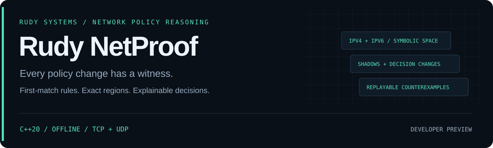

<p align="center"></p>

<p align="center">
  <a href="https://github.com/r4venrudy/rudy-netproof/actions/workflows/ci.yml"></a>
  
  <a href="LICENSE"></a>
  <a href="https://rudy.systems"></a>
</p>

**A rule looks restrictive. An earlier allow makes it unreachable. A small IPv6 prefix edit opens an enormous address range. NetProof shows the exact decision changes and packets that demonstrate them.**

Rudy NetProof is an offline first-match network-policy reasoning engine written in C++20. It partitions IPv4/IPv6 source and destination address space, TCP/UDP protocols, and source/destination port intervals into disjoint decision regions. It finds fully and partially shadowed rules, explains their earlier decisive owners, and compares policies by behavior rather than rule text.

Developer preview · stateless TCP/UDP model · exact symbolic rectangle operations · no live probes, agents, firewall access, solver service, or runtime dependencies.

## What you can establish

| Question | Evidence |
| --- | --- |
| Can this rule ever decide a packet? | Exact raw and reachable tuple counts, a reachable witness, and shadowing status |
| What prevents it from being reached? | Earlier first-match owners, blocked tuple counts, and representative witnesses; unions of earlier rules are handled |
| What does this edit newly allow or deny? | Exact changed regions, arbitrary-precision counts, and a counterexample with both decisive rule IDs |
| Are two differently structured policies equivalent? | Comparison across their complete declared address-family scopes; rule names and partition shapes do not determine equivalence |
| Why is this particular tuple allowed? | The decisive rule and every later matching rule, in original order |
| Can a reviewer inspect this offline? | JSON, readable text, expandable self-contained HTML, and a DOT shadowing graph |
| Can CI reject an accidental opening? | Separate `opened`, `changed`, and `shadowed` gates; incomplete computations fail with status `2` |

“Exact” applies to this declared model, not an installed firewall. The tool does not parse vendor configurations or model NAT, connection tracking, routing, interfaces, TCP state, fragments, ICMP, or policy chains. A witness is a mathematical counterexample; NetProof never sends it. Tuple counts are address/port combinations, not observed connections, reachable hosts, or risk scores.

## Install and try

Download your platform's archive from [Releases](https://github.com/r4venrudy/rudy-netproof/releases), verify its hash in `SHA256SUMS.txt`, and extract it. Packages include the executable, synthetic example policies, generated HTML investigations, documentation, and dependency notices. Windows uses `bin\netproof.exe`; Linux and macOS use `bin/netproof`. Packages target Linux x64 (built on Ubuntu 24.04), Windows x64, and macOS ARM64 (built on macOS 15). Older OS compatibility is unverified; system libraries must be available.

```sh
bin/netproof analyze examples/baseline.json
bin/netproof analyze examples/baseline.json --format html --output investigation.html
bin/netproof compare examples/baseline.json examples/candidate.json --format json
bin/netproof compare examples/baseline.json examples/candidate.json --fail-on opened
bin/netproof analyze examples/baseline.json --format dot --output shadowing.dot
```

The synthetic baseline contains a dead deny rule after a broader allow. The candidate moves that deny earlier, introduces an IPv4 debug listener, and broadens an IPv6 destination prefix. The comparison identifies both newly allowed and newly denied regions. It does not contact any example address.

Explain a concrete tuple:

```sh
bin/netproof explain examples/baseline.json --source 192.0.2.10 --destination 198.51.100.10 --source-port 50000 --destination-port 443 --protocol tcp --format json
```

Output paths must be new. Existing files, hard links, and symbolic links are refused. Reports contain policy names, addresses, and rule IDs: treat them as sensitive configuration material when appropriate.

## Build and test

Requirements: CMake 3.20+, a C++20 compiler, and a build tool. The JSON dependency is vendored and hash-pinned; builds download nothing. Python 3.9+ is optional for the independent process/format contract suite and is not a tool runtime dependency.

```sh
cmake -S . -B build -DCMAKE_BUILD_TYPE=Release
cmake --build build --config Release --parallel
ctest --test-dir build --build-config Release --output-on-failure
cmake --install build --config Release --prefix stage
```

The executable is `build/netproof` for single-configuration Unix builds and `build/Release/netproof.exe` with Visual Studio. The installed layout matches release packages.

The C++ suite contains 1,427 deterministic/property assertions, including **53,760 independently evaluated packet comparisons** across generated IPv4 and IPv6 policies, 80 subtraction-conservation cases, exact 288-bit-scale counts, union shadowing, partition-independent equivalence, budget failures, and witness replay. A separate standard-library Python suite checks process behavior, independent IPv4/IPv6 cardinalities and example witnesses, new-file output, formats, and CI gates. Symbolic links are tested when the OS permits creating them.

CI builds on Linux, Windows, and macOS, and adds Linux AddressSanitizer/UndefinedBehaviorSanitizer. Release packaging waits for those checks, then smoke-tests the installed layout on each target OS.

## Policy format

```json
{
  "schema": "rudy-netproof/policy-v1",
  "name": "Example HTTPS ingress model",
  "family": "ipv4",
  "default": "deny",
  "rules": [
    {
      "id": "https",
      "action": "allow",
      "protocol": "tcp",
      "source": "192.0.2.0/24",
      "destination": "198.51.100.0/24",
      "sourcePorts": [1024, 65535],
      "destinationPorts": [443, 443]
    }
  ]
}
```

Every field above is required. Rules are evaluated in array order; the first match wins. `family` is `ipv4`, `ipv6`, or `dual`; comparisons require identical family scopes. `protocol: "any"` means **TCP and UDP**, and a rule address `"any"` covers the relevant policy families. Port intervals are inclusive. CIDRs must have zero host bits. IPv6 accepts hexadecimal groups and one `::` compression; zone IDs and embedded dotted IPv4 forms are refused. DNS names and address resolution are unsupported.

Duplicate JSON keys, duplicate IDs, unknown fields, unsupported protocols, mixed address families, reversed intervals, and malformed/oversized inputs are errors. An effective deny rule may still be behaviorally redundant with the default: shadowing describes reachability, not deletion safety.

## Gates, budgets, and reproducibility

| Exit | Meaning |
| --- | --- |
| `0` | Complete computation; requested failure gate not reached |
| `1` | Complete computation; requested failure gate reached |
| `2` | Invalid input/options, resource budget exhaustion, or I/O error; no complete proof established |

`analyze --fail-on shadowed` fails for fully shadowed rules. `compare --fail-on opened` fails for any newly allowed tuple; `--fail-on changed` fails for any decision difference. These use the complete analysis, including rows omitted from display.

| Budget | Default | Ceiling |
| --- | --- | --- |
| Input JSON | 8 MiB; 32 nesting levels; 500 rules | Fixed |
| Box-pair operations | 5,000,000 | 50,000,000 via `--max-operations` |
| Cumulative generated regions | 200,000 | 500,000 via `--max-fragments` |
| Displayed rows per collection | 100 | 500 via `--rows` |
| Rendered report | 16 MiB | Fixed |

Comparison shares one computation budget across both partitions and their intersections. Resource exhaustion stops the operation before any report is written. Computations are exact or fail; there is no sampled or approximate fallback. OS memory/time limits remain useful for unfamiliar inputs. Policy reports are deterministic for the same input order and options; the partition count can change when equivalent rules are split or reordered.

## Architecture and evidence

- [Rectangle algebra, invariants, and model boundaries](docs/DESIGN.md)
- [Report contract and witness replay](docs/REPORTS.md)
- [Validation and limitations](docs/VALIDATION.md)
- [Synthetic scenarios](examples/README.md)
- [Security boundaries](SECURITY.md) · [Dependency provenance](THIRD_PARTY.md) · [Contributing](CONTRIBUTING.md)

**RUDY Systems · Network policy reasoning** · [Project home](https://rudy.systems) · [MIT license](LICENSE)
